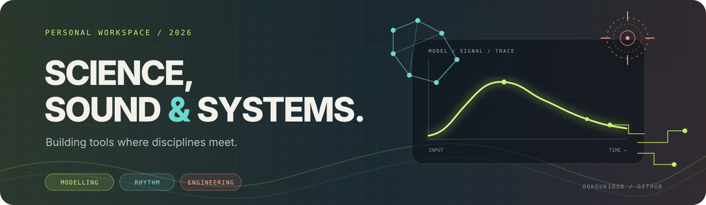
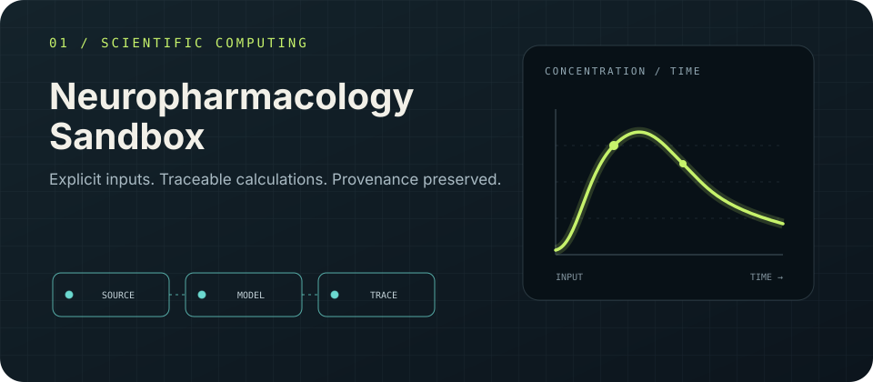
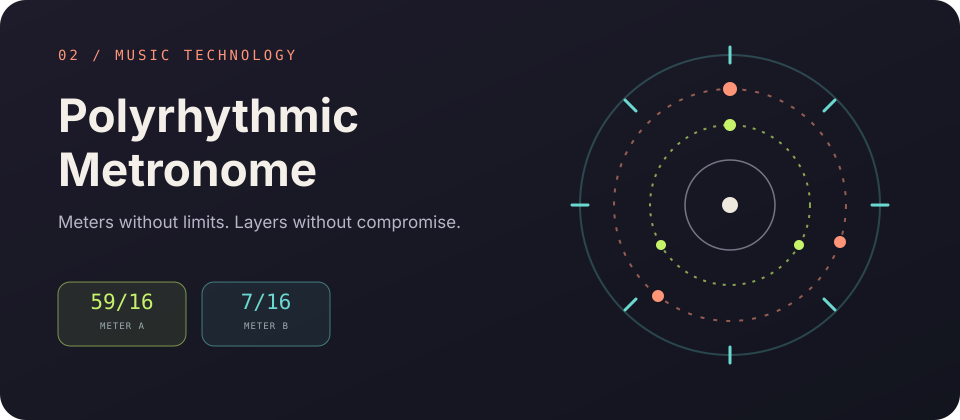
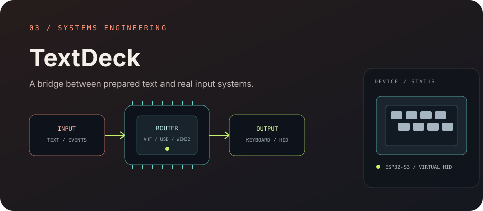

  
  
<strong>学生开发者 · 软件构建者 · 跨学科探索者</strong>

  
<em>在不同学科的交汇处构建工具。</em>

  
<a href="README.md">English</a>

---

## 关于我

我喜欢把不同领域中的想法转化为可测试、可理解、可实际使用的工具。我的项目主要横跨**科学计算、音乐技术与系统工程**，并且始终关注一个共同的问题：如何让复杂行为变得透明，而不是把它藏在黑箱里。

我也对 AI、哲学与认知研究感兴趣。离开编辑器之后，音乐和乐器仍然是我持续探索的领域。

## 代表项目

<table>
  <tr>
    <td width="33%" valign="top">
      
      <h3 align="center">01 · Neuropharmacology Sandbox</h3>
      
<strong>科学计算</strong>

      
一个 local-first 药理学计算环境，强调显式输入、可追踪公式与数据溯源。包含 PK/PD 模型、实验数据集、保留来源信息的数据导入，以及可复现的计算过程。

      
<a href="https://github.com/ookoukibob/Neuropharmacology-Sandbox">查看仓库 →</a>

    </td>
    <td width="33%" valign="top">
      
      <h3 align="center">02 · Polyrhythmic Metronome</h3>
      
<strong>音乐技术</strong>

      
支持任意拍号与独立节奏层的离线节拍器。提供自定义分组、重音/静音模式、Web Audio 前瞻调度，以及 Web、Windows 和 Android 构建版本。

      
<a href="https://github.com/ookoukibob/polyrhythmic-metronome">查看仓库 →</a>

    </td>
    <td width="33%" valign="top">
      
      <h3 align="center">03 · TextDeck</h3>
      
<strong>系统工程</strong>

      
Windows 输入工具集，将预先准备的文本与事件映射接入多个后端：Win32 SendInput、自研 KMDF/VHF 虚拟 HID 驱动，以及 ESP32-S3 USB HID 设备。

      
<a href="https://github.com/ookoukibob/TextDeck">查看仓库 →</a>

    </td>
  </tr>
</table>

## 我的工程习惯

- **让假设可见。** 输入、单位、来源和限制都应该可以检查。
- **构建真正有用的工具。** 项目应当解决具体问题，并且能脱离源代码本身被使用。
- **尊重系统边界。** 硬件、操作系统、浏览器和科学模型都有值得诚实记录的约束。

## 近期兴趣

`AI 辅助开发` · `嵌入式系统` · `科学软件` · `音频编程` · `人机交互` · `Local-first 工具`

## 其他兴趣

音乐与乐器 · 哲学 · 认知 · 精神药理学 · 实验性交互

---

由好奇心驱动，每次构建一个子系统。
